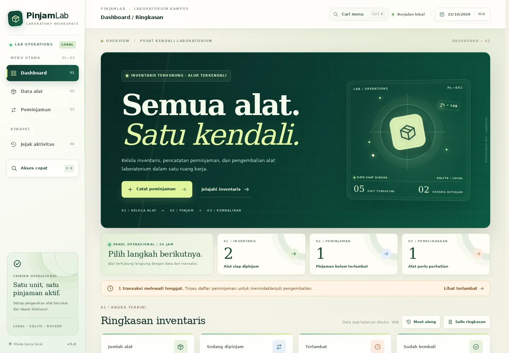
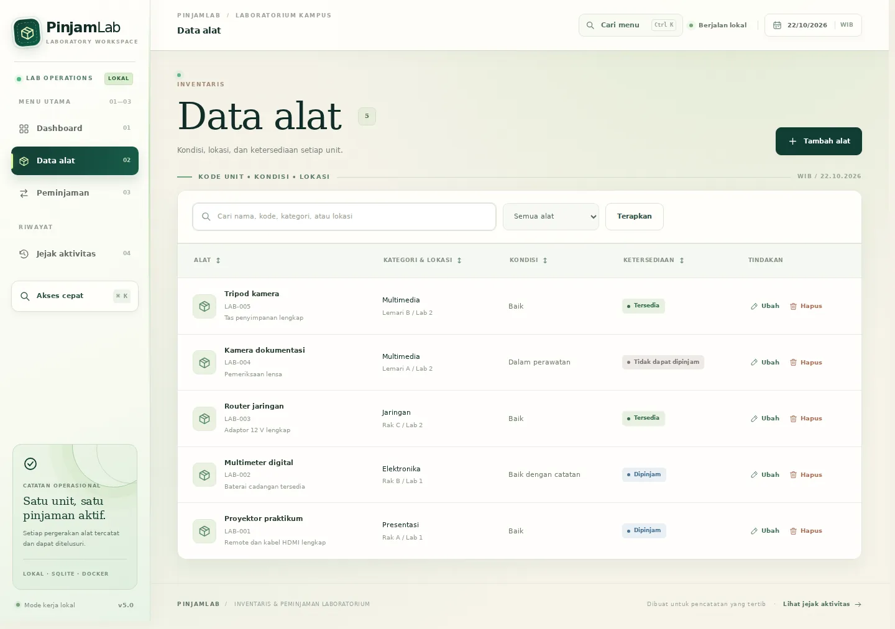
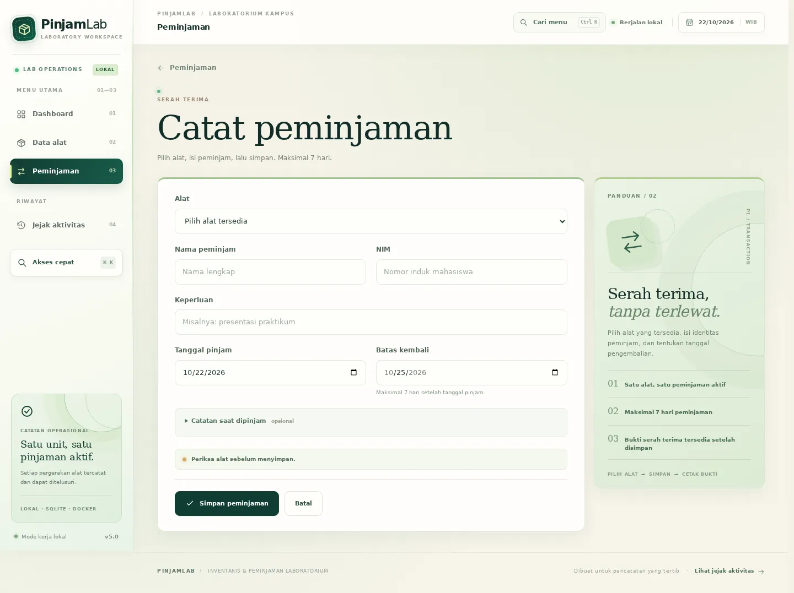
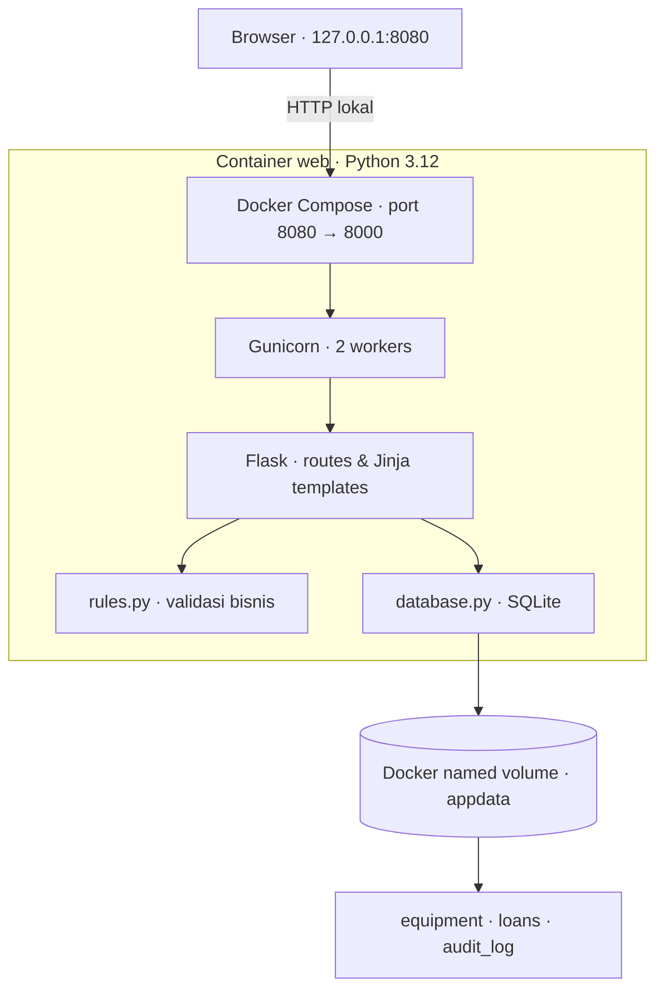

<p align="center">
  
</p>

<h1 align="center">PINJAMLAB</h1>
<h3 align="center">LAB JOURNAL EDITION · V5.0</h3>

<p align="center">
  <strong>Satu ruang kerja untuk mengelola inventaris, peminjaman, dan pengembalian alat laboratorium.</strong>
</p>
<p align="center">
  Aplikasi web CRUD berbasis <strong>Flask + SQLite</strong>, dikemas dalam <strong>Docker</strong>,<br />
  dengan antarmuka responsif, riwayat aktivitas, dan data persisten.
</p>

<p align="center">
  <a href="PROJECT_INFO.md"></a>
  <a href="Dockerfile"></a>
  <a href="requirements.txt"></a>
  <a href="schema.sql"></a>
  <a href="compose.yaml"></a>
</p>
<p align="center">
  <a href="https://github.com/RasidinHarahap/coko-pinjamlab/actions/workflows/verify.yml"></a>
  
  
</p>

<p align="center">
  <a href="#-mulai-dalam-3-langkah">Mulai Menjalankan</a> &nbsp;·&nbsp;
  <a href="#-fitur-utama">Lihat Fitur</a> &nbsp;·&nbsp;
  <a href="#-arsitektur-sistem">Arsitektur</a> &nbsp;·&nbsp;
  <a href="#-pengujian-dan-quality-check">Pengujian</a> &nbsp;·&nbsp;
  <a href="#-memperbarui-repository-github">Upload GitHub</a>
</p>

---

> [!NOTE]
> **Proyek pembelajaran Tim Coko.** PinjamLab ditujukan untuk penggunaan **lokal pada komputer petugas**. GitHub menyimpan source dan menjalankan pemeriksaan CI; repository ini **bukan layanan hosting website publik**.

## ✦ Preview aplikasi

<p align="center">
  
</p>

<table>
  <tr>
    <td width="50%" align="center"><br /><sub><b>01 / Inventaris</b> — pencarian, filter, dan operasi CRUD</sub></td>
    <td width="50%" align="center"><br /><sub><b>02 / Peminjaman</b> — identitas, jadwal, dan validasi</sub></td>
  </tr>
</table>

<sub>Gambar berasal dari dokumentasi antarmuka versi 5.0 dalam laporan proyek, bukan simulasi hasil deployment publik.</sub>

## ✦ Mengapa PinjamLab?

Pencatatan inventaris laboratorium membutuhkan **identitas unit yang jelas** dan **riwayat transaksi yang saling terhubung**. PinjamLab menerapkan *satu kode unik untuk satu unit fisik*, sehingga status ketersediaan tidak hanya bergantung pada kondisi alat, tetapi juga pada transaksi peminjaman aktif.

| INVENTARIS | SIKLUS PEMINJAMAN | KONTROL DATA |
|:--|:--|:--|
| Kode unik, kategori, lokasi, kondisi, pencarian dan filter | Catat, ubah, kembalikan, cetak bukti, ekspor CSV | Validasi server, constraint SQLite, audit log, backup dan volume persisten |

## ✦ Fitur utama

| Modul | Kemampuan |
|---|---|
| **Dashboard operasional** | Ringkasan alat terdaftar, tersedia, dipinjam, terlambat, dikembalikan, dan perlu perhatian; tombol muat ulang dan salin ringkasan. |
| **CRUD inventaris** | Tambah, baca, ubah, dan hapus data unit alat beserta kode, nama, kategori, lokasi, kondisi, dan catatan. |
| **CRUD peminjaman** | Catat peminjam/NIM, kebutuhan, tanggal, kondisi awal, edit transaksi, dan hapus sesuai relasi data. |
| **Pengembalian alat** | Catat tanggal, kondisi akhir, dan catatan; kondisi inventaris ikut diperbarui pada transaksi database yang sama. |
| **Bukti & ekspor** | Bukti serah terima siap cetak atau simpan PDF dari browser, serta ekspor transaksi CSV berdasarkan filter. |
| **Pencarian & navigasi** | Filter status, pengurutan tabel pada browser, dan pencarian menu dengan **Ctrl / ⌘ + K**. |
| **Jejak aktivitas** | Catatan tindakan penambahan, perubahan, pengembalian, dan penghapusan (tanpa identitas akun petugas). |
| **Docker & persistensi** | Build image, startup otomatis, healthcheck, dan penyimpanan SQLite pada named volume. |

<details>
<summary><b>Aturan bisnis yang diterapkan</b></summary>

- **Satu unit = satu kode alat unik**; satu transaksi mengacu ke satu unit.
- Kondisi **Baik** atau **Baik dengan catatan** dapat dipinjam jika tidak ada transaksi aktif. Kondisi **Dalam perawatan** dan **Rusak** tidak dapat dipinjam.
- Durasi peminjaman paling lama **7 hari**; tanggal pinjam tidak boleh melebihi tanggal saat ini menurut **Asia/Jakarta**.
- Satu alat hanya boleh mempunyai **satu peminjaman aktif**. Constraint indeks unik parsial pada SQLite ikut menjaga aturan tersebut.
- Status **Terlambat** berlaku untuk peminjaman aktif yang batas kembalinya sudah lewat; status dihitung saat data diminta, bukan melalui push otomatis.
- Pengembalian dengan kondisi selain **Baik** mewajibkan catatan.
- Alat yang masih direferensikan transaksi tidak dapat dihapus sampai transaksi terkait dihapus sesuai aturan *foreign key*.

</details>

## ✦ Mulai dalam 3 langkah

**Target:** Windows dengan [Docker Desktop](https://docs.docker.com/desktop/setup/install/windows-install/) dan **Linux containers** aktif. Tidak perlu menginstal Python, Node.js, atau XAMPP secara terpisah untuk metode Docker.

1. **Unduh atau clone source.** Jika memakai ZIP, lakukan **Extract All** terlebih dahulu, lalu buka folder yang berisi `Dockerfile` dan `compose.yaml`.
2. **Buka Docker Desktop** hingga engine berjalan. Pastikan menggunakan mode **Linux containers**.
3. **Klik dua kali `MULAI_DI_SINI.cmd`.** Skrip akan memeriksa Docker, menyiapkan `.env` dengan kunci acak jika belum ada, membangun image, menjalankan container, dan membuka browser ketika aplikasi siap.

<p align="center">
  <strong><code>http://127.0.0.1:8080</code></strong><br />
  <sub>Alamat default setelah container berhasil dinyalakan</sub>
</p>

> [!TIP]
> Pada database inventaris yang masih kosong, skrip pembuka menambahkan **data contoh berlabel DEMO**. Data yang sudah ada tidak ditimpa. Build pertama memerlukan koneksi internet untuk mengambil image dan dependency.

### Perintah alternatif: PowerShell / Terminal

Dari **folder root proyek**:

```powershell
# Cara alternatif di Windows: setup lingkungan + build + startup
powershell.exe -NoProfile -ExecutionPolicy Bypass -File .\scripts\jalankan.ps1

# Periksa container dan port
docker compose ps

# Periksa endpoint kesehatan
Invoke-RestMethod http://127.0.0.1:8080/health

# Lihat 30 baris log terbaru
docker compose logs --tail=30 web
```

Jika menggunakan perintah Docker Compose langsung, siapkan `.env` terlebih dahulu melalui `scripts/setup-env.ps1`. Respons sehat yang diharapkan pada endpoint `/health` mencantumkan `status: ok`, `database: SQLite connected`, dan `version: 5.0`.

## ✦ Arsitektur sistem



| Lapisan | Teknologi | Peran |
|---|---|---|
| Antarmuka | HTML, CSS, JavaScript, Jinja | Halaman responsif, form, tabel, dan interaksi lokal. |
| Backend | Python 3.12 · Flask 3.1.2 | Route, sesi/CSRF, validasi, dan proses transaksi. |
| Server | Gunicorn 23.0.0 | Menjalankan aplikasi dengan dua worker. |
| Penyimpanan | SQLite melalui `sqlite3` | Tabel berelasi, transaksi, constraint, dan audit. |
| Container | Dockerfile + Docker Compose | Image `pinjamlab:5.0`, port lokal, healthcheck, dan runtime non-root. |
| Persistensi | Named volume `appdata` | Menyimpan berkas SQLite di `/app/data` di luar writable layer container. |

> [!IMPORTANT]
> **SQLite tidak membutuhkan container database kedua** pada arsitektur ini karena SQLite berjalan sebagai pustaka di proses aplikasi. **Volume persisten bukan backup** dan tidak menjamin data selamat dari seluruh jenis kegagalan.

## ✦ Alur demonstrasi end-to-end

| Tahap | Aksi di antarmuka | Hasil yang diperiksa |
|:--:|---|---|
| 01 | Buka dashboard | Data ringkasan berasal dari database, bukan angka dekoratif. |
| 02 | Tambah alat berkode `DEMO-LAP-01` | Unit tampil di daftar inventaris. |
| 03 | Cari kode, lalu ubah nama alat | Nilai baru tersimpan dan jejak Ubah muncul. |
| 04 | Buat transaksi peminjaman alat tersebut | Alat menjadi tidak tersedia untuk pinjaman aktif kedua. |
| 05 | Buka bukti dan cetak | Identitas, jadwal, dan kondisi awal tampil. |
| 06 | Ubah keperluan atau jadwal yang valid | Data transaksi dan bukti terbarui. |
| 07 | Catat pengembalian dan kondisi akhir | Status menjadi Dikembalikan; kondisi inventaris diperbarui. |
| 08 | Filter transaksi, lalu ekspor CSV | Hasil ekspor mengikuti filter yang dipakai. |
| 09 | Hapus transaksi demonstrasi, lalu alat | Relasi database tetap konsisten. |
| 10 | Buka Jejak aktivitas | Tindakan tersimpan dapat ditelusuri. |

Gunakan kode contoh lain jika `DEMO-LAP-01` sudah ada. Tampilan dashboard menghitung ulang data setelah request/muat ulang; **tidak ada pembaruan realtime otomatis** pada versi ini.

## ✦ Pengujian dan quality check

| 7 | 8 | 27 | 13 |
|:---:|:---:|:---:|:---:|
| **SQLite integrity** | **Business rules** | **Flask + database** | **HTTP smoke** |

**Total pengujian yang disiapkan:** **55 kasus** (48 kasus aplikasi/HTTP + 7 pemeriksaan SQLite), ditambah demonstrasi persistensi setelah container dibuat ulang.

**Cara menjalankan pengujian Docker pada Windows:** klik dua kali **`UJI_WEBSITE.cmd`** setelah Docker Desktop aktif. Skrip menyalakan aplikasi jika diperlukan, menjalankan rangkaian pengujian, membuat marker persistensi, merekreasi container, dan memeriksa marker kembali.

```powershell
# Menjalankan pengujian dari PowerShell
powershell.exe -NoProfile -ExecutionPolicy Bypass -File .\scripts\uji.ps1

# Lokasi log lokal setelah uji dijalankan
# .local\LOG_UJI.txt
```

**Yang sudah terdokumentasi pada audit 26 Oktober 2026:** 8/8 uji aturan bisnis, 7/7 pemeriksaan integritas SQLite terisolasi, render 9 template, serta pemeriksaan 45 kombinasi halaman/ukuran viewport Chromium. **Audit tersebut tidak memverifikasi engine Docker maupun Gunicorn.** Hasil Docker/CI yang sah adalah keluaran aktual dari komputer atau [GitHub Actions](https://github.com/RasidinHarahap/coko-pinjamlab/actions) setelah source ini diunggah. Lihat [catatan audit](HASIL_AUDIT_2026-10-26.md) untuk lingkup dan batasan bukti.

### CI di GitHub Actions

Workflow [`.github/workflows/verify.yml`](.github/workflows/verify.yml) dikonfigurasi untuk berjalan saat **push ke `main`**, saat pull request, atau ketika dijalankan manual. Langkahnya mencakup build, healthcheck, ketiga kelompok uji aplikasi, pemeriksaan SQLite, dan verifikasi persistensi volume. **Status kelulusan hanya dapat dipastikan setelah workflow selesai di GitHub.**

## ✦ Struktur repository

```text
coko-pinjamlab/
├── .github/workflows/verify.yml     # CI build, test, persistence
├── docs/screenshots/               # Gambar asli dari laporan proyek
├── templates/                      # Dashboard, inventaris, form, bukti
├── static/                         # CSS, JavaScript, favicon lokal
├── scripts/                        # Setup, test, demo data, backup
├── app.py                           # Route dan alur aplikasi
├── rules.py                         # Validasi & aturan bisnis
├── database.py                      # Koneksi & transaksi SQLite
├── init_db.py                       # Inisialisasi database
├── schema.sql                       # Skema, relasi & indeks
├── Dockerfile                       # Instruksi build image
├── compose.yaml                     # Service web dan volume
├── requirements.txt                 # Dependency Python
├── MULAI_DI_SINI.cmd                # Jalankan website pada Windows
├── UJI_WEBSITE.cmd                  # Pengujian Docker pada Windows
├── UPLOAD_KE_GITHUB.cmd             # Upload source dengan konfirmasi
├── MANIFEST_GITHUB.txt              # Daftar aman file untuk push
├── PANDUAN_UPLOAD_GITHUB.md         # Instruksi autentikasi dan upload
├── PROJECT_INFO.md                 # Identitas dan transparansi sumber
└── README.md                       # Dokumentasi utama ini
```

## ✦ Memperbarui repository GitHub

**Repository tujuan:** [`RasidinHarahap/coko-pinjamlab`](https://github.com/RasidinHarahap/coko-pinjamlab) · **branch:** `main`.

1. Instal [Git for Windows](https://git-scm.com/downloads/win); [GitHub CLI](https://cli.github.com/) opsional untuk login browser yang lebih mudah.
2. Ekstrak paket PinjamLab ke folder biasa. **Jangan jalankan file CMD dari dalam ZIP.**
3. Klik dua kali **`UPLOAD_KE_GITHUB.cmd`** dan login GitHub jika diminta.
4. Skrip akan **clone `main` terbaru**, menyalin file yang ada pada `MANIFEST_GITHUB.txt`, lalu menampilkan daftar perubahan.
5. Setelah memeriksa daftar, ketik **`YA`** untuk melakukan commit dan push **tanpa force push**.
6. Periksa [Code](https://github.com/RasidinHarahap/coko-pinjamlab) dan [Actions](https://github.com/RasidinHarahap/coko-pinjamlab/actions).

> [!CAUTION]
> Skrip tidak memasukkan `.env`, database `*.sqlite3`, log, atau isi folder `.local` ke commit. Jangan mengunggah kredensial, database personal, atau hasil backup ke repository publik. File lama di remote yang tidak ada dalam manifest **tidak dihapus secara otomatis**.

Panduan lebih rinci tersedia di **[PANDUAN_UPLOAD_GITHUB.md](PANDUAN_UPLOAD_GITHUB.md)**. GitHub Actions pada proyek ini melakukan **continuous integration**, bukan menerbitkan layanan Flask secara publik.

## ✦ Troubleshooting

<details>
<summary><b>Docker Desktop belum berjalan / Docker daemon tidak tersedia</b></summary>

Buka Docker Desktop dan tunggu sampai engine aktif; gunakan Linux containers. Kemudian jalankan kembali `MULAI_DI_SINI.cmd`. Periksa `docker info` dan `docker compose version` di terminal.

</details>

<details>
<summary><b>Port 8080 sudah dipakai aplikasi lain</b></summary>

Buka `.env` di folder proyek dan ubah `APP_PORT=8080` menjadi `APP_PORT=8081`. Jalankan ulang pembuka, lalu akses `http://127.0.0.1:8081`. Jangan ubah port internal 8000 tanpa memperbarui konfigurasi terkait.

</details>

<details>
<summary><b>Halaman belum bisa dibuka / healthcheck belum sehat</b></summary>

Jalankan `docker compose ps` dan `docker compose logs --tail=80 web` untuk melihat penyebabnya. Log pembuka Windows tersimpan di `.local/LOG_MULAI.txt` dan log pengujian di `.local/LOG_UJI.txt` setelah skrip masing-masing dijalankan.

</details>

<details>
<summary><b>GitHub menolak push / autentikasi gagal</b></summary>

Pastikan akun GitHub memiliki izin tulis terhadap repository, Git Credential Manager atau `gh auth login` telah berhasil, dan branch tidak sedang dibatasi aturan proteksi. Jika ada perubahan baru pada `main`, jalankan ulang skrip untuk clone versi terbaru. **Jangan gunakan `git push --force`** untuk menimpa riwayat.

</details>

<details>
<summary><b>Apakah data hilang saat container dibuat ulang?</b></summary>

Database utama berada pada named volume `appdata`, bukan pada layer container. `docker compose up -d --force-recreate` seharusnya mempertahankan volume yang sama. **Jangan gunakan `docker compose down -v`** apabila data ingin disimpan: flag `-v` menghapus named volume proyek.

</details>

## ✦ Lingkup, keamanan, dan originalitas

- **Lingkup:** demonstrasi lokal pada komputer petugas; belum menyediakan login, multi-role, notifikasi otomatis, atau portal mandiri peminjam.
- **Keamanan:** port default di-bind ke `127.0.0.1`; CSRF dan validasi diterapkan, tetapi itu **bukan** pengganti autentikasi dan kontrol akses jika hendak dipublikasikan ke internet.
- **Backup:** volume membantu persistensi, tetapi tetap membutuhkan prosedur backup dan pemulihan terpisah.
- **Originalitas:** pemilihan kasus, alur bisnis, integrasi fitur, dan pengujian didokumentasikan sebagai proyek kelompok. Proses desain serta pengembangan source mendapat **bantuan ChatGPT dan OpenAI Codex**, diungkapkan secara terbuka pada [informasi proyek](PROJECT_INFO.md). Teknologi dan dependency pihak ketiga tidak diklaim sebagai ciptaan kelompok.

## ✦ Tim pengembang

| Anggota | NIM |
|:---|:---|
| **Rasidin Harahap** | `231110869` |
| **Ade Kurnia Setialu** | `231110333` |
| **Arsenius P. Sinaga** | `231111699` |

**Tim Coko · Tugas Kelompok 1 MID · Pengenalan DevOps**  
**Dosen pengampu:** Irpan Adiputra Pardosi

---

<p align="center">
  <strong>PINJAMLAB · INVENTORY IN ORDER. LOANS IN CONTROL.</strong><br />
  <sub>Dokumentasi source versi 5.0 · penggunaan lokal · bukti operasional perlu diverifikasi pada lingkungan yang menjalankannya.</sub><br />
  <a href="#pinjamlab">↑ Kembali ke atas</a>
</p>
